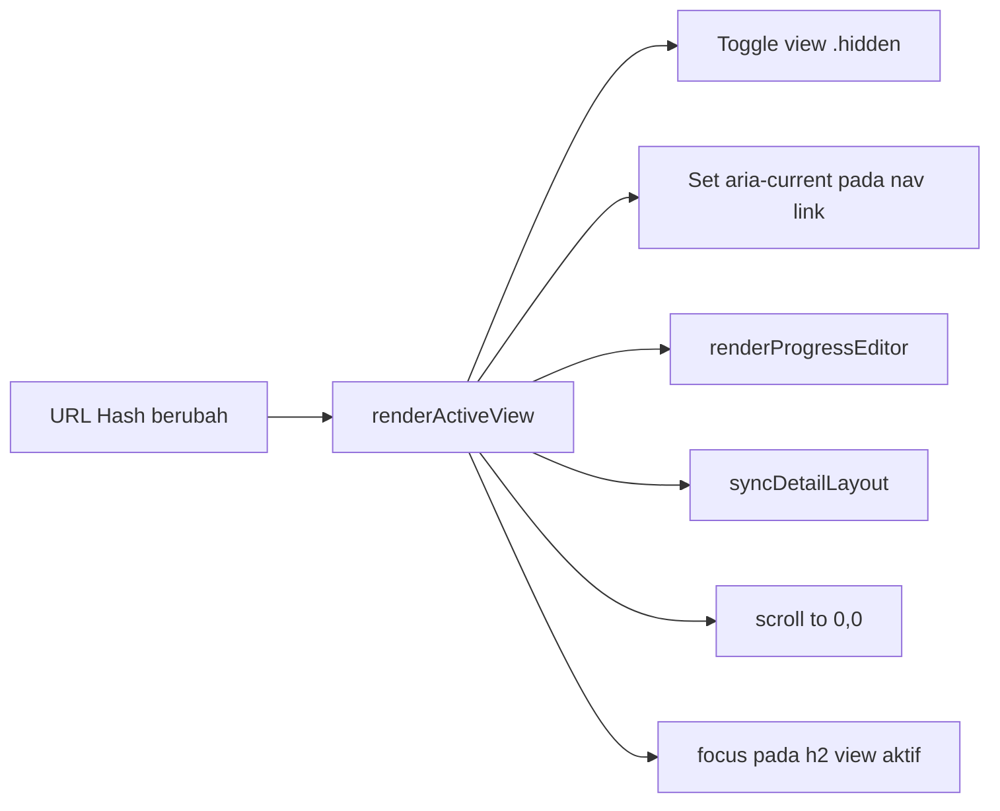
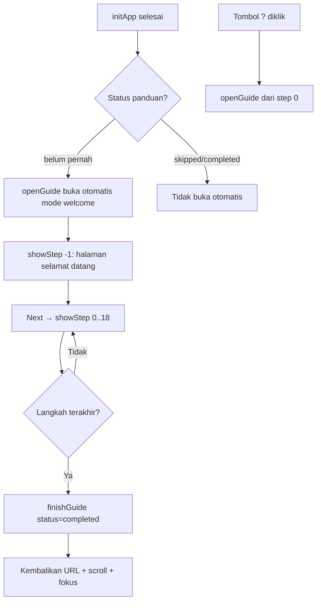
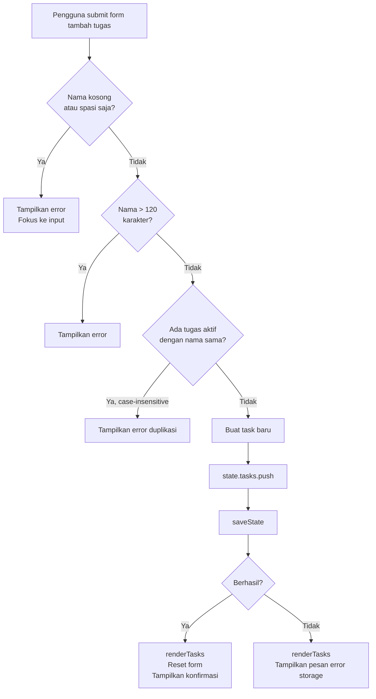

# Design — Tuntas: Arsitektur dan Implementasi Aktual

**Versi:** 1.0  
**Catatan:** Dokumen ini mendokumentasikan implementasi sebenarnya berdasarkan pembacaan kode. Bagian yang menggambarkan rencana atau usulan diberi label **[PROP]**; bagian yang sudah ada di kode diberi label **[IMPL]**.

---

## 1. Arsitektur Aplikasi

Tuntas adalah single-page application (SPA) tanpa framework, tanpa build step. Seluruh aplikasi terdiri dari tiga file:

```
index.html   → struktur HTML + dialog statik
css/style.css → tampilan + tema + responsivitas
js/app.js    → seluruh logika, state, rendering, event handling
```

### Pola Arsitektur [IMPL]

```
[ Browser ]
     │
     ├─ index.html         (struktur awal, elemen DOM)
     ├─ style.css          (tampilan, tema via CSS variables)
     └─ app.js
           ├─ applyInitialTheme()   ← dijalankan SEBELUM DOMContentLoaded
           └─ initApp()             ← dijalankan saat DOMContentLoaded
                 ├─ collectElements()   ← cache referensi DOM
                 ├─ loadState()         ← baca localStorage
                 ├─ bindEvents()        ← pasang semua event listener
                 ├─ render*()           ← render awal semua komponen
                 └─ setInterval(1s)     ← update jam + timer
```

Tidak ada virtual DOM, tidak ada state management library. Setelah setiap perubahan state, fungsi `render*()` yang relevan dipanggil ulang untuk menyinkronkan DOM.

---

## 2. Struktur File dan Entry Point

### `index.html`
- `<script src="./js/app.js">` ditempatkan di `<head>` **tanpa** `defer` — disengaja agar `applyInitialTheme()` berjalan sebelum browser merender body, mencegah flash tema.
- Empat `<section data-view="...">` berfungsi sebagai view yang di-toggle dengan `hidden` attribute:
  - `data-view="beranda"` — home view
  - `data-view="tugas"` — tasks panel
  - `data-view="fokus"` — focus panel
  - `data-view="akses-cepat"` — links panel
- Dialog statik di HTML: `#link-dialog`, `#guide-dialog`, `#detail-dialog`, `#name-dialog`, `#edit-task-dialog`, `#choice-dialog`.

### `js/app.js`
Urutan eksekusi:
1. Definisi konstanta dan konfigurasi.
2. `applyInitialTheme()` — dipanggil langsung (synchronous, IIFE-like).
3. Deklarasi variabel elemen dan state.
4. Definisi fungsi (tidak ada eksekusi di sini).
5. Entry condition: `if (document.readyState === "loading") { addEventListener("DOMContentLoaded", initApp) } else { initApp() }`.

---

## 3. Navigasi dan Pengelolaan View

### Mekanisme Routing [IMPL]

Navigasi berbasis **URL hash** (`window.location.hash`):

- `#beranda` → home view
- `#tugas` → tasks view
- `#fokus` → focus view
- `#akses-cepat` → links view



Klik link internal (`<a href="#view">`) dicegah default-nya dan diteruskan ke `navigateToView()` via event listener `document.click`.

`hashchange` event memicu `renderActiveView()` — mendukung navigasi browser back/forward.

---

## 4. State Aplikasi

### Struktur State [IMPL]

```javascript
{
  schemaVersion: 3,          // Integer: versi schema (1, 2, atau 3)
  selectedTaskId: null,      // String|null: ID tugas yang dipilih di panel detail
  tasks: [],                 // Array<Task>
  links: [],                 // Array<Link>
  theme: null,               // "light" | "dark" | null (null = ikut sistem)
  nickname: "",              // String, 0–30 karakter, sudah di-trim
  focusMinutes: 25,          // Integer, 1–180 (preferensi durasi sesi baru)
  timer: {
    status: "idle",          // "idle" | "running" | "paused" | "finished"
    taskId: null,            // String|null: ID tugas yang terhubung ke timer
    durationSeconds: 1500,   // Integer: durasi sesi ini (detik)
    remainingSeconds: 1500,  // Integer: sisa waktu (detik)
    endAt: null,             // Number|null: timestamp (ms) saat timer akan habis
  }
}
```

### Model Task [IMPL]

```javascript
{
  id: "uuid-v4",             // String: crypto.randomUUID()
  title: "Nama tugas",       // String, 1–120 karakter
  priority: "medium",        // "high" | "medium" | "low"
  status: "not_started",     // "not_started" | "in_progress" | "completed"
  createdAt: 1700000000000,  // Number: Unix timestamp (ms)
  updatedAt: 1700000000000,  // Number: Unix timestamp (ms)
  resumeNote: "",            // String, 0–2000 karakter
}
```

### Model Link [IMPL]

```javascript
{
  id: "uuid-v4",             // String: crypto.randomUUID()
  label: "GitHub",           // String, 1–50 karakter
  url: "https://github.com", // String: URL valid (http/https)
}
```

---

## 5. Local Storage

### Key dan Format [IMPL]

| Key | Konten | Format |
|---|---|---|
| `tuntas:v1` | State aplikasi lengkap | JSON string dari objek state |
| `tuntas:onboarding` | Status panduan | `{"status": "completed"|"skipped", "version": 1}` |

### Nilai Default [IMPL]

Saat tidak ada data di localStorage, `createInitialState()` menghasilkan:
- `tasks: []`, `links: []`, `theme: null`, `nickname: ""`
- `focusMinutes: 25` (DEFAULT_FOCUS_MINUTES)
- Timer: `status: "idle"`, `durationSeconds: 1500`, `remainingSeconds: 1500`, `endAt: null`

### Cara Pemuatan [IMPL]

```
localStorage.getItem("tuntas:v1")
  → null          → createInitialState()
  → invalid JSON  → sesi sementara, pesan error, tidak menimpa data lama
  → JSON valid    → isValidState(parsed)
                      → false → sesi sementara, pesan error
                      → true  → migrateState(parsed) → gunakan state
```

Setelah migrasi dari v1/v2, state langsung disimpan kembali dan notifikasi ditampilkan.

---

## 6. Logika CRUD Tugas

### Tambah Tugas [IMPL]

```
handleAddTask()
  → getTaskTitleError(title)         ← validasi kosong, panjang, duplikat
  → state.tasks.push(newTask)
  → saveState()
  → renderTasks()
```

### Validasi Duplikasi [IMPL]

Fungsi `hasDuplicateTask(title, excludedTaskId)`:
- Membandingkan `normalizeTaskTitle(title)` (= `title.trim().toLowerCase()`) dengan semua tugas aktif.
- Tugas completed dikecualikan dari pengecekan.
- Parameter `excludedTaskId` digunakan saat edit (mengecualikan tugas yang sedang diedit).

### Pengurutan [IMPL]

Fungsi `getSortedTasks()` membuat salinan array `state.tasks` (tidak mengubah aslinya) dan mengurutkan dengan kriteria:

1. **Selalu:** Tugas completed (`isTaskCompleted`) diletakkan di bawah tugas aktif.
2. **Berdasarkan `taskSort.value`:**
   - `"priority"` (default): `PRIORITIES[p].rank` → `createdAt` (terlama dulu) → `id.localeCompare`.
   - `"status"`: `TASK_STATUSES[s].rank` → lalu priority sort.
   - `"newest"`: `-createdAt` → `id.localeCompare`.
   - `"oldest"`: `+createdAt` → `id.localeCompare`.

### Perubahan Status dengan Konfirmasi [IMPL]

`setTaskStatus(taskId, nextStatus)` memanggil `runGuardedAction()` untuk mencegah aksi konkuren. Alur:

```
setTaskStatus()
  → cek apakah "reopening" (completed → non-completed)
  → jika reopening: cek duplikasi aktif → tolak jika ada
  → jika perubahan melibatkan timer (status bukan in_progress dan timer taskId sama):
      → prepareTaskChange() → resolveResumeDrafts() → askConfirmation() reset timer
  → ubah task.status + task.updatedAt
  → saveState() + renderTasks()
```

---

## 7. Saran Tugas Berikutnya

### Mekanisme [IMPL]

Fungsi `getSuggestedTask()`:

```javascript
// Ambil semua tugas aktif (bukan completed)
const activeTasks = state.tasks.filter(t => !isTaskCompleted(t));
// Urutkan berdasarkan priority rank, lalu createdAt, lalu id
activeTasks.sort(compareTaskPriority);
// Kembalikan yang pertama
return activeTasks[0] ?? null;
```

**Ini bukan AI** — hanya pengurutan deterministik berdasarkan prioritas dan waktu pembuatan.

Teks yang ditampilkan di kartu saran: `"Prioritas [tinggi/sedang/rendah] · Tugas terlama pada prioritas ini"`.

Tombol saran: menampilkan "Kerjakan ↗" (jika tidak ada sesi aktif) atau "Lanjutkan fokus ↗" (jika tugas tersebut sudah terhubung ke timer aktif).

---

## 8. Timer

### Cara Kerja [IMPL]

Timer menggunakan **timestamp absolut** (`endAt`) bukan hitungan tick:

- Saat Start: `endAt = Date.now() + remainingSeconds * 1000`.
- Setiap detik (`setInterval`): `getRemainingSeconds()` menghitung `Math.ceil((endAt - Date.now()) / 1000)`.
- Saat tab kembali aktif (`visibilitychange`): `refreshTimer()` dipanggil untuk mengecek apakah timer sudah selesai.
- Berpindah tab atau reload: timer terus berjalan karena `endAt` tersimpan di localStorage.

### Status Timer [IMPL]

| Status | Kondisi |
|---|---|
| `idle` | `remainingSeconds === durationSeconds`, belum pernah dijalankan atau sudah di-reset |
| `running` | `endAt !== null`, hitungan mundur aktif |
| `paused` | `endAt === null`, `remainingSeconds` menyimpan sisa waktu |
| `finished` | `remainingSeconds === 0`, sesi selesai |

### Pemisahan `durationSeconds` vs `focusMinutes` [IMPL]

- `timer.durationSeconds` — durasi sesi timer **yang sedang berjalan** (bisa berbeda dari preferensi).
- `state.focusMinutes` — preferensi durasi untuk **sesi baru** berikutnya.
- Saat "Terapkan sesi berikutnya": hanya `focusMinutes` berubah, `timer.durationSeconds` tetap.
- Saat "Reset sesi ini": keduanya diperbarui, timer di-reset ke `focusMinutes` baru.

---

## 9. Tema

### Mekanisme Tema [IMPL]

```
applyInitialTheme()          ← saat script dimuat (sebelum DOM)
  → baca localStorage["tuntas:v1"].theme
  → set document.documentElement.dataset.theme
  → set document.documentElement.style.colorScheme

applyTheme(theme)            ← saat toggle atau setelah initApp
  → update dataset.theme
  → update src/srcset logo (light/dark)
  → update ikon tombol (sun/moon)
  → update aria-pressed

toggleTheme()
  → state.theme = dark/light
  → applyTheme(state.theme)
  → saveState()
```

CSS menggunakan selector `:root[data-theme="dark"]` untuk menimpa custom properties tema terang.

Jika `state.theme === null`, `getPreferredTheme()` menggunakan `window.matchMedia("(prefers-color-scheme: dark)")`. Perubahan sistem preference dideteksi via `systemTheme.addEventListener("change", ...)`.

---

## 10. Personalisasi Nama

### Alur [IMPL]

Dialog `#name-dialog` → input `#nickname` → `handleNameSave()`:
- Validasi: tidak kosong, tidak lebih dari 30 karakter.
- Simpan ke `state.nickname`.
- Panggil `updateClock()` untuk memperbarui sapaan segera.
- Sapaan format: `"${greeting.slice(0, -1)}, ${nickname}."` (menghapus titik akhir sapaan lalu tambah koma dan nama).

---

## 11. Jam dan Tanggal

### Mekanisme [IMPL]

`updateClock()` dipanggil setiap detik via `setInterval`. Menggunakan:
- `Intl.DateTimeFormat("id-ID", { hour: "2-digit", minute: "2-digit", hourCycle: "h23" })` — jam 24 jam dengan separator `:`
- `Intl.DateTimeFormat("id-ID", { weekday: "long", day: "numeric", month: "long", year: "numeric" })` — tanggal panjang Indonesia
- Sapaan berdasarkan jam: 05:00–10:59 = Pagi; 11:00–14:59 = Siang; 15:00–17:59 = Sore; 18:00–04:59 = Malam.

---

## 12. Akses Cepat

### Deteksi Platform [IMPL]

Fungsi `getLinkPlatform(url)` memeriksa hostname URL:

| Domain | Platform ID | Tampilan |
|---|---|---|
| `github.com` | `github` | Ikon mask GitHub SVG |
| `youtube.com`, `youtu.be` | `youtube` | Ikon mask YouTube SVG |
| `gitlab.com` | `gitlab` | Ikon mask GitLab SVG |
| Lainnya | `generic` | Ikon link SVG inline |

Ikon platform dirender via CSS `mask` property menggunakan SVG dari `assets/icons/platforms/`.

### Normalisasi URL [IMPL]

`normalizeLinkUrl(value)` menangani input yang tidak lengkap:
- `github.com` → `https://github.com`
- `//github.com` → `https://github.com`
- URL dengan protokol non-http/https → ditolak (return `null`).
- URL dengan karakter whitespace di hostname → ditolak.

---

## 13. Onboarding / Panduan

### Alur [IMPL]



**19 langkah panduan** mencakup: dashboard (5 langkah) → tugas (5 langkah) → fokus (5 langkah) → akses cepat (4 langkah).

### Mekanisme Positioning [IMPL]

- `positionGuide()` menggunakan `getBoundingClientRect()` untuk mengukur target dan panel.
- Panel ditempatkan di kanan/kiri/bawah/atas target tergantung ruang yang tersedia.
- Highlight (`#guide-highlight`) dibuat menggunakan `position: fixed` dengan dimensi yang sama dengan target yang terlihat.
- `ResizeObserver` memantau perubahan ukuran target dan panel untuk reposisi otomatis.
- Scroll target otomatis ke dalam viewport saat berpindah langkah.

### Status Onboarding [IMPL]

Tersimpan di `localStorage['tuntas:onboarding']`:
- `{ status: "completed", version: 1 }` — panduan selesai dilakukan.
- `{ status: "skipped", version: 1 }` — panduan dilewati.
- Tidak ada data → panduan belum pernah dijalankan → buka otomatis.

---

## 14. Layout Responsif

### Breakpoint [IMPL]

| Breakpoint | CSS | Perilaku |
|---|---|---|
| Mobile | `max-width: 639px` | Navigasi bottom bar, layout satu kolom, detail sebagai dialog |
| Tablet | `640px–1023px` | Sidebar ikon (label hidden), header horizontal |
| Desktop | `min-width: 1024px` | Sidebar dengan label teks |
| Desktop lebar | `min-width: 1200px` | Detail tugas inline di samping daftar |

### Deteksi di JS [IMPL]

Tiga `MediaQueryList` digunakan:
- `mobileLayout = window.matchMedia("(max-width: 639px)")` — memicu `syncResponsiveLayout()` saat berubah.
- `compactDetailLayout = window.matchMedia("(max-width: 1199px)")` — mengontrol apakah detail ditampilkan inline atau sebagai dialog.

### Perpindahan DOM Mobile ↔ Desktop [IMPL]

Saat mobile: `mobileHeader.append(brandLink, headerTools)` — logo dan tools dipindah ke area header mobile.  
Saat non-mobile: `sidebar.prepend(brandLink)` dan `headerActions.append(headerTools)` — elemen dikembalikan ke sidebar.

---

## 15. Aksesibilitas

### Yang Sudah Ada [IMPL]

- Semua tombol ikon: `aria-label` via `decorateIconButton()`.
- Input invalid: `aria-invalid="true"` + pesan error terhubung via `aria-describedby`.
- Dialog native `<dialog>` dengan `showModal()` — focus trap otomatis (dan ditambah handler Tab manual untuk dialog link dan detail).
- Timer: `role="timer"` dan status `role="status"`.
- Heading hierarki konsisten: h1 → h2 → h3 → h4.
- Elemen dekoratif: `aria-hidden="true"`.
- CSS `prefers-reduced-motion`: transisi tombol, link, dan select dimatikan.
- `safe-area-inset` CSS env untuk notched device.
- `font-size: 16px` pada input di mobile untuk mencegah auto-zoom iOS.

### Aksesibilitas yang Belum Diverifikasi

- Pengujian dengan screen reader (NVDA, JAWS, VoiceOver) belum dilakukan.
- Pengujian navigasi keyboard penuh (Tab order, focus management lintas dialog) belum diformalkan.
- Contrast ratio warna belum diaudit secara formal terhadap WCAG 2.1 AA.

---

## 16. Penanganan Input Pengguna dan URL Eksternal

### Input Teks [IMPL]

Semua konten dari input pengguna ditulis menggunakan `textContent` (bukan `innerHTML`) untuk mencegah XSS. Ikon dibuat via DOM API (`document.createElementNS`).

### URL Eksternal [IMPL]

- Semua tautan akses cepat menggunakan `target="_blank"` + `rel="noopener noreferrer"`.
- URL divalidasi dengan `new URL()` dan hanya protokol `http:` dan `https:` yang diterima.

---

## 17. Dependensi dan Aset Eksternal

Tuntas tidak menggunakan CDN, tidak ada dependensi npm, tidak ada skrip dari pihak ketiga. Semua aset disimpan lokal:

| Aset | Sumber | Lokasi |
|---|---|---|
| Logo Tuntas | Dokumen proyek | `assets/Icon/` |
| Ikon platform (GitHub, YouTube, GitLab) | Lisensi tertera di `assets/icons/platforms/LICENSE.md` | `assets/icons/platforms/` |
| Font sistem | `-apple-system, BlinkMacSystemFont, "Segoe UI", sans-serif` | Browser |

---

## 18. Keterbatasan Penyimpanan Lokal

- Data hanya tersimpan di satu browser dan satu perangkat — tidak ada sinkronisasi lintas perangkat.
- Browser dapat membatasi atau menghapus localStorage (mode incognito, storage eviction).
- Tidak ada enkripsi atau proteksi tambahan — data tersimpan dalam plain JSON.
- Kapasitas umumnya 5–10MB per origin, namun tidak ada pengukuran aktual ukuran data Tuntas.
- Kemampuan offline tidak diuji secara eksplisit — tidak ada Service Worker.

---

## 19. Diagram Alur Tambah Tugas


